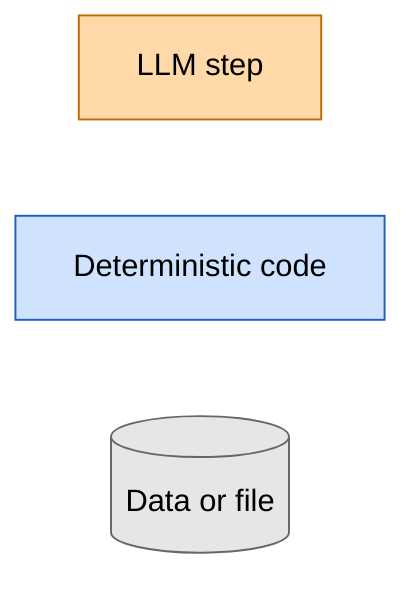
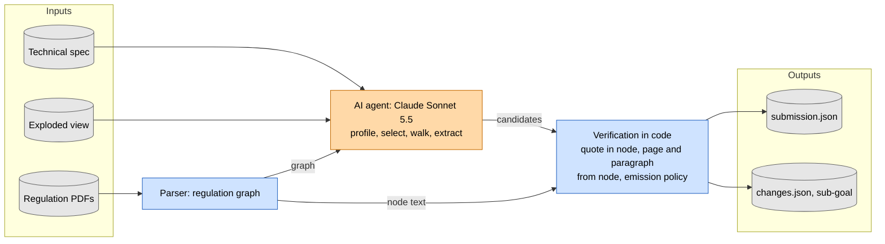
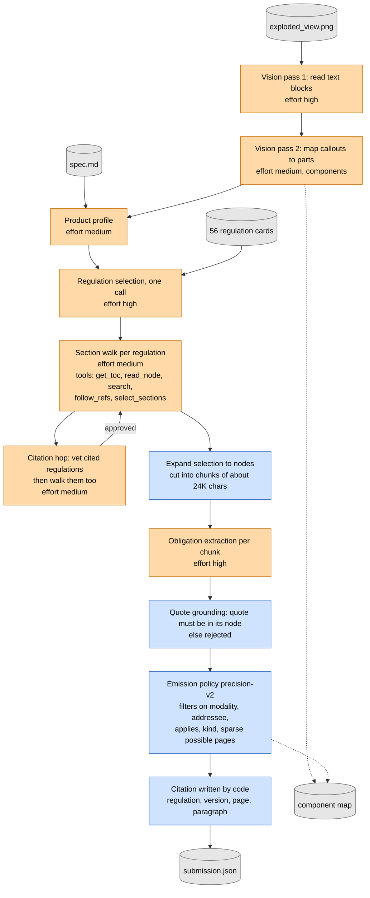
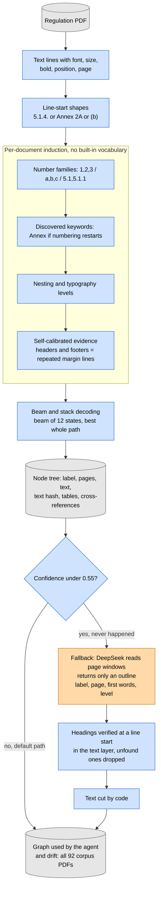
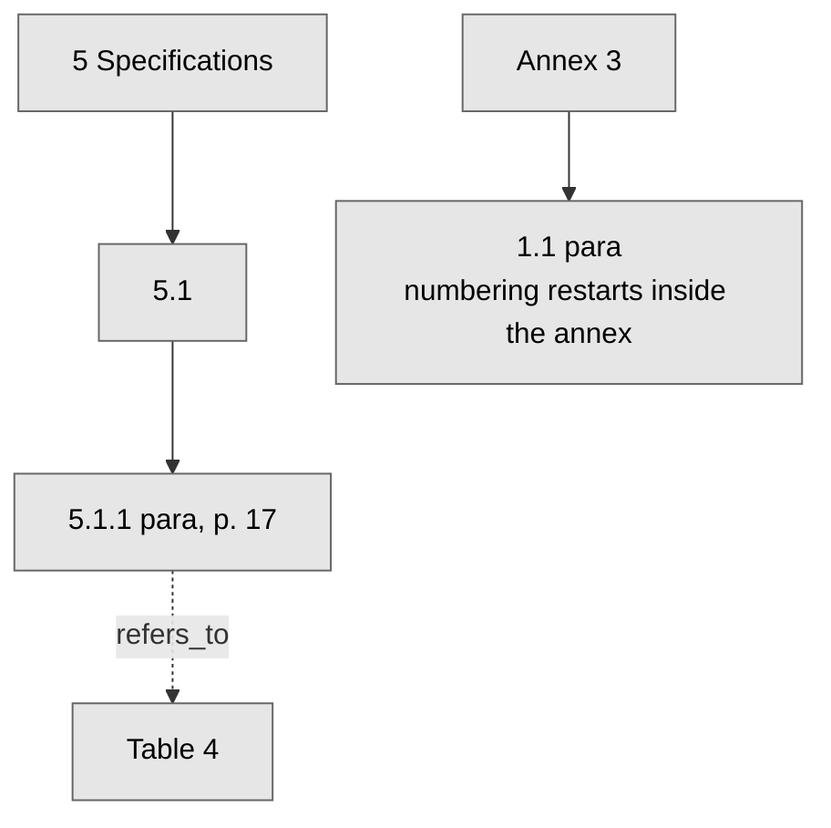
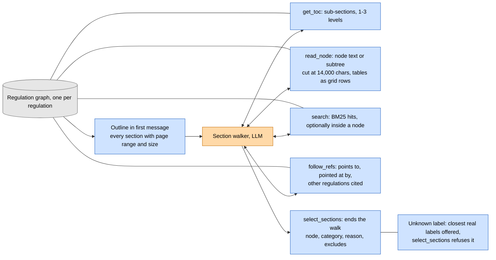
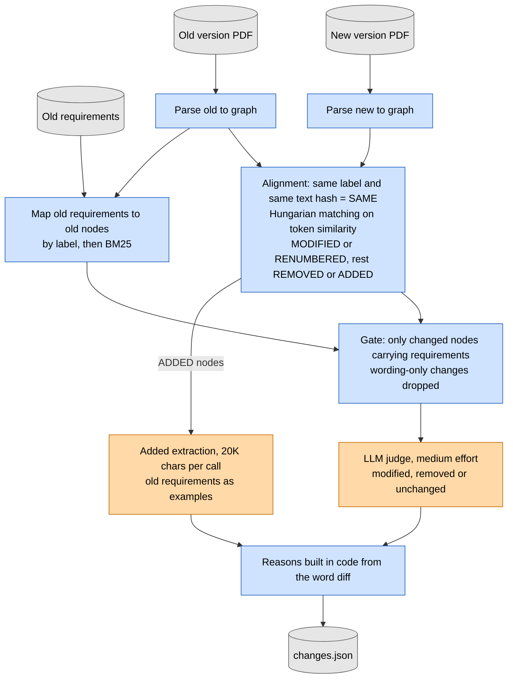
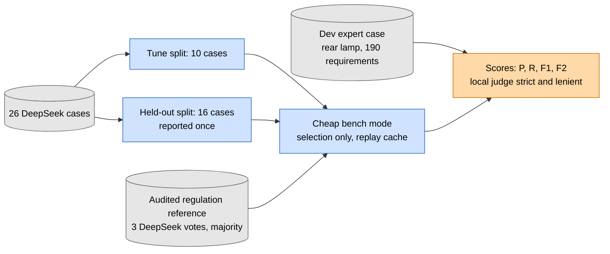

# Team DeepFry: AI agent diagrams

Diagrams for the pitch and the technical document. Colour code in every diagram: **orange = LLM step** (Claude Sonnet 5.5, unless stated), **blue = deterministic code**, **grey = data or files**.

*Legend.* The same three classes are used in all diagrams below.

## 1. Big picture: models decide, code verifies

The agent reads the spec and drawing, and reads regulations through a graph that a deterministic parser built. The model makes the judgement calls: which regulations apply, which sections, which obligations. Code then checks every quote against the node text and writes page, paragraph, regulation and version itself, so the model never writes a citation. The same chain produces `submission.json` (main goal) and `changes.json` (sub-goal).

## 2. Main-goal pipeline

Vision reads the drawing in two passes and feeds the facts into a product profile. One call picks regulations from 56 cards. A walker per regulation reads the outline and selects sections. Regulations cited by the selected text are vetted and walked too. Extraction runs on chunks at high effort, and code then grounds each quote, applies the precision-v2 filters and writes the citation. The component map (requirement to part, `components`, medium effort) is a side artifact. Optional steps, such as the selection verifier (`verify`, medium), are off by default.

## 3. How the regulation graph is built

The submission uses the marker parser with per-document induction, which learns the numbering scheme, keywords and nesting from each document itself. A confidence check follows. Only a low score (under 0.55) triggers the DeepSeek outline fallback, and it never did on the 92 corpus PDFs. In the fallback the model writes only an outline: code verifies each heading in the text layer and cuts the text itself.

Example tree (R148 style):

## 4. What the agent reads from the graph

The walker starts with the outline already in its first message, so it often selects straight away. Five tools, each bound to one regulation, let it look inside when titles are unclear. The agent names nodes by label, and code answers every tool call from the graph. Code rejects any label that does not exist.

## 5. Drift pipeline (sub-goal)

Both versions are parsed and aligned by code, so renumbering and page shifts never reach the model. Old requirements are mapped to nodes, and only a changed node that carries requirements is sent to the judge. Added paragraphs go to an extraction call. Code writes the reasons from the word diff. This keeps a run at $0.00 to $0.08, and the held-out R171 case at $0.42.

## 6. Evaluation setup

The expert dev case is the one trustworthy yardstick. The 26 DeepSeek cases have a noisy gold, so we split them: tune on 10, report 16 held out. An audited regulation reference, built from three DeepSeek votes per candidate, corrects the noisiest gold labels. The cheap bench mode scores regulation selection without running extraction.
